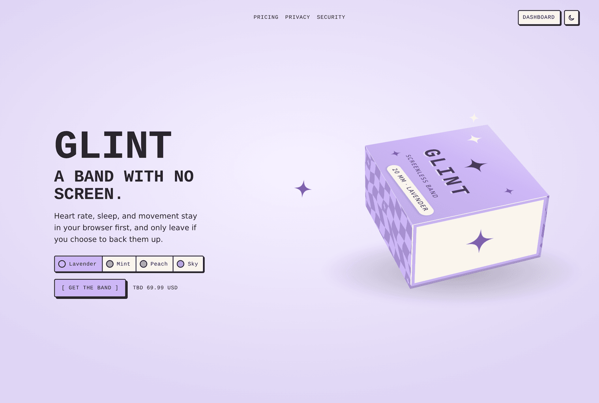
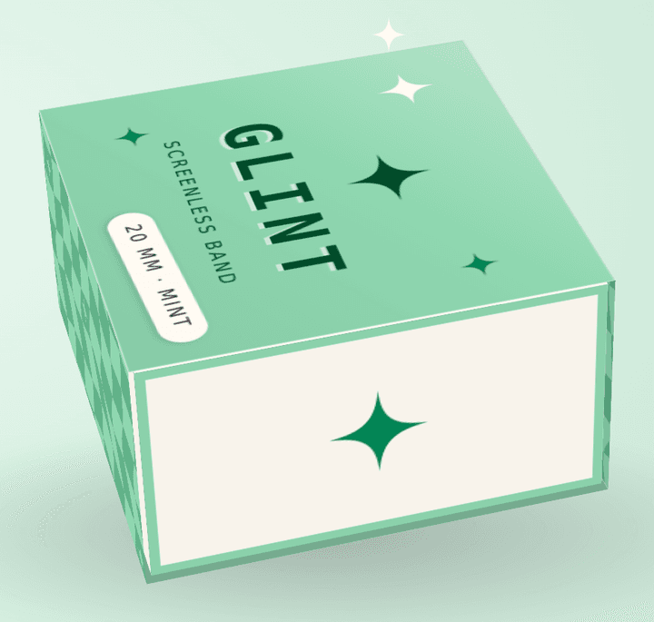
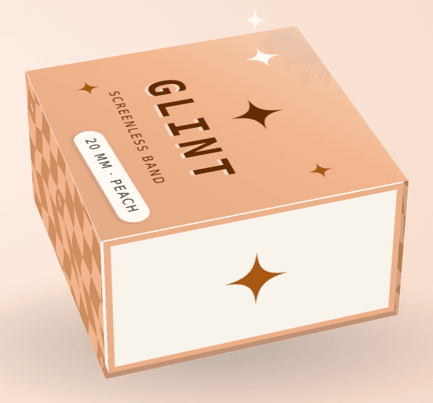
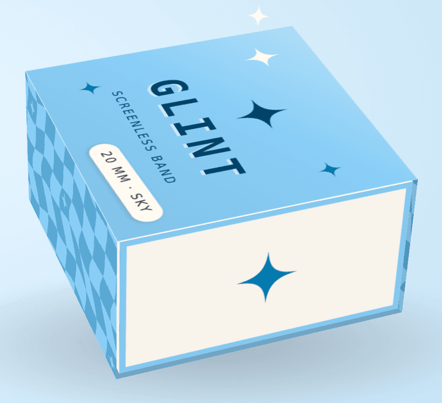
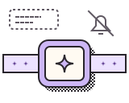
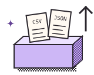
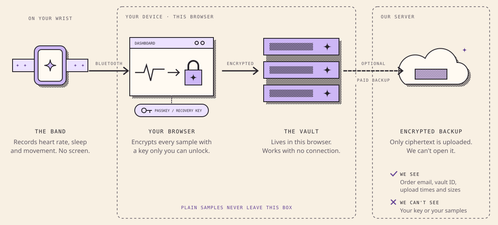

# Glint

**A band with no screen.**  
Heart rate, sleep, and movement stay in your browser first,  
and only leave if you choose to back them up.

[Live site](https://fluffy9.github.io/glint/) · [Dashboard](https://fluffy9.github.io/glint/dashboard) · Security · Health data

  




## Why?

I wanted to buy a fitness tracker without a screen and felt there weren't enough privacy friendly options. I started to vibe code something and this is where we are so far. 


## Packaging

WIP mockups


         

Lavender · Mint · Peach · Sky

## Features


|                                           |                                                                                                                                         |
| ----------------------------------------- | --------------------------------------------------------------------------------------------------------------------------------------- |
|         | **No BS** No ads, no streaks, no leaderboards, no monthly subscriptions.                                                                |
|    | **No screen** It's low-key. It does one thing well, tracking your fitness. Not a replacement for your watch or your phone.              |
|       | **Local first** Made with an offline-first mentality. Data stays on your device, and in your browser, and in the cloud only optionally. |
|    | **No account** The dashboard is free. No sign-in necessary.                                                                             |
|          | **Encrypted backup** Data is encrypted locally in your browser. Keys never leave your device.                                           |
|  | **Never sold** There is no data held to be sold, and even if there was we wouldn't do it.                                               |
|        | **Export anytime** Export however you'd like. Upload to Google Drive, or take a plain CSV or JSON copy of your data.                    |
|         | **Delete anytime** No logs retained, data is truly deleted on request.                                                                  |


## How it works



## Repository

```text
glint/
├── app/                 Next.js routes (home, pricing, dashboard, …)
├── components/          Site UI, packaging box, dashboard
├── content/             Copy and site constants
├── design-system/       Tokens, components, brand + feature art
├── docs/                Security, health data, README art
├── functions/           Stripe webhook + backup API
├── lib/                 Vault, passkeys, band, commerce helpers
├── packaging/           Box mock source
└── scripts/             Seeds, README art export
```

## Run

```sh
pnpm install
cp .env.example .env
pnpm --dir functions install
pnpm dev
```

Checkout stays off until `NEXT_PUBLIC_STRIPE_LINK_BAND` and `NEXT_PUBLIC_STRIPE_LINK_BACKUP` are set.

### Local backup (emulators)

With no cloud keys in `.env`, `/dashboard` talks to local emulators through `/__glint/*`. Java 21+ is required.

```sh
pnpm emulators
```

In another terminal:

```sh
pnpm seed:purchase buyer@example.com
pnpm dev
```

Open `http://localhost:3000/dashboard` (or `127.0.0.1`) and stay on that host. Create or unlock a vault, redeem the seeded session, then upload or restore ciphertext. Forward real Payment Links with:

```sh
stripe listen --forward-to http://127.0.0.1:5001/glint-local/us-central1/stripeWebhook
```


## Tests

```sh
pnpm test
pnpm test:e2e
```

`pnpm test` also runs in the commit hook (with typecheck).

## README art

```sh
pnpm dev
pnpm export:readme
```

Assets land in `[docs/readme/](docs/readme/)`.